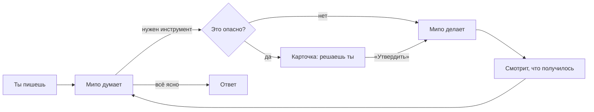

# Мипо — помощник, который сам учится новому


**Мипо** (Meepo) — помощник, который живёт прямо у тебя в компьютере. С ним можно поболтать, попросить что-нибудь найти, прочитать файлы, пройтись по сайту в браузере или записать заметку. А если Мипо чего-то не умеет, он не притворяется: говорит «я так не умею» и предлагает научиться. Учится — только когда ты скажешь «да».

## Как устроен Мипо

### Голова

Внутри Мипо — **языковая модель**. Это программа, которая прочитала очень много текстов и научилась их продолжать: ты пишешь вопрос, а она дописывает ответ. Модель может работать на твоём компьютере (её запускают Ollama или LM Studio) — тогда разговоры никуда не улетают. А можно подключить и сервер на работе или в облаке: адрес и ключ вводятся в окне **«⚙ Настройки»**.

Голова у Мипо небольшая: за раз в ней помещается немного текста — примерно как номер телефона, который ты держишь в голове, пока набираешь. Как Мипо с этим справляется, рассказано [ниже](#как-мипо-не-забывает-главное).

### Глаза — картинки

Мипо умеет смотреть на картинки. Вставь скриншот или фото прямо в поле ввода (**Ctrl+V**), перетащи файл или нажми **＋**. Можно спросить, что на картинке, попросить переписать таблицу со скриншота или сохранить картинку в заметку вики — она появится в заметке, а не потеряется вместе с разговором.

### Руки — инструменты

Говорить мало, хочется делать. Для этого у Мипо есть **инструменты**:

- прочитать или записать файл — даже очень большой: сначала оглавление, потом нужные страницы;
- перевести PDF, Word, Excel или PowerPoint в Markdown — коннектор «Документ → Markdown»;
- поискать в интернете;
- открыть сайт в настоящем браузере и пощёлкать по нему. Красная точка в окне браузера показывает, куда Мипо навёл мышку;
- записать заметку в вики.

Всё, что может что-нибудь испортить (записать файл, нажать кнопку на сайте), Мипо сначала **спрашивает**. Прямо в чате появляется карточка, и ты нажимаешь «Утвердить» или «Отклонить». Можно и ответить словами: «сделай, но назови файл по-другому».

Пока Мипо работает, в чате не мелькает каждый шаг: все вызовы инструментов и промежуточные мысли свёрнуты в строку **«◇ ход работы · 12 шагов»** над ответом. Раскрой её — и увидишь всё по порядку.

### Как Мипо учится новому

Если подходящего инструмента нет, Мипо прямо говорит: «Я так не умею. Давай сделаю себе такой инструмент?» — и показывает карточку: что он хочет сделать, зачем и сам код. Ты читаешь и решаешь. Без твоего «да» ничего не появится.

Научиться Мипо может двум вещам:

| Что | На что похоже | Где лежит |
| --- | --- | --- |
| Скилл | Как делать задачи одного типа; большая работа — ещё и по шагам, которые идут сами | `data/skills/<id>/` |
| Инструмент | Новая «рука»: умеет одно конкретное дело | `data/tools/<id>/` |

Всё это — обычные файлы. На вкладке «Возможности» две вкладки — «Скиллы» и «Инструменты»: что это, ваши возможности и «Заготовки Мипо», а внизу — общий архив. Скилл и коннектор открываются папкой: слева файлы, справа текст; у скилла можно добавить steps.md (из шаблона) и скрипт или удалить файл, «Сохранить» записывает папку, только если она рабочая. Инструменты разложены на три группы: встроенные, коннекторы (скрипты из `data/tools`) и серверы MCP — у сервера и у каждого его инструмента есть переключатель. Заготовки идут вместе с Мипо — скиллы для тестировщика (тест-кейсы по документации, автотесты, проверка в браузере, разбор задачи из Jira и другие) и коннекторы — к Jira и «Документ → Markdown»; «Включить» кладёт копию в `data/`, и дальше это ваша возможность. Скилл можно создать кнопкой «＋ Новый скилл», любую возможность — поправить в окне или руками и нажать «Перечитать с диска». Ненужное Мипо предлагает убрать в архив, оттуда его можно вернуть.

### Скиллы и работа по шагам

Скилл — это папка:

```
data/skills/test-cases/
├── SKILL.md      когда скилл нужен и как делать работу (имя и описание — в блоке --- сверху)
├── steps.md      необязательно: та же работа по шагам
└── scripts/      необязательно: скрипты, которые запускают шаги
    └── testcases.py
```

Большую работу маленькой модели лучше не отдавать целиком: она запутается, где была и что дальше. Поэтому у скилла могут быть **шаги** (`steps.md`) — работа, разбитая на шаги, как в кулинарной книге. Порядок шагов соблюдает программа, а модель каждый раз делает только свой шаг — с понятным заданием и нужными файлами под рукой.

Шаги бывают пяти видов:

- **модель** — один ответ модели: выписать правила, проверить чужую работу;
- **агент** — модель с инструментами: пройти сценарий в браузере, разложить тесты по файлам;
- **команда** — программа в папке проекта: скачать шаблон, запустить pytest;
- **инструмент** — один вызов инструмента: прочитать задачу из Jira;
- **скрипт** — скрипт из папки `scripts/` скилла в песочнице: например, генератор тест-кейсов. Ему доступна та же модель, что в чате.

У шага-модели может быть строка `по частям: {документ}`: тогда он проходит большой документ частями — задание выполняется для каждой части отдельно, а ответы подряд пишутся в файл. Остановился посередине — следующий запуск продолжит с той же части.

Итог шага записывается в файл, и следующий шаг его читает. Если шаг не получился — например, упали тесты, — работа возвращается к нужному шагу и отдаёт модели текст ошибки: «при ошибке: Написать тесты, 3».

Как это выглядит: пишешь «напиши тест-кейсы по документации из docs/lk», и Мипо показывает карточку — поля «Нужно от вас» (что знал, уже заполнил), шаги и что они будут делать с проектом. Нажимаешь «▶ Запустить» — и в чате видно, как идут шаги: ✓ готово, ◌ идёт, ✕ не получилось. В конце в чате остаётся отчёт: что сделал каждый шаг и какие файлы появились. Запустить шаги можно и самому — кнопкой «▶ Запустить по шагам» на карточке скилла во вкладке «Возможности → Скиллы».

Новый скилл — с шагами или без — Мипо предлагает сам («сделай скилл для API-тестов по задачам Jira»): карточка покажет инструкции, шаги и скрипты, и скилл появится только после твоего «да». Доработать скилл, в том числе его скрипт (например, формат таблицы тест-кейсов), Мипо тоже может только с твоего «да».

**Тест-кейсы по документации** — скилл `test-cases`. Скрипт режет каждую страницу на куски и пишет кейсы по каждому куску в едином формате (`testgen/test_cases/<путь страницы>`), затем ревьюер сверяет кейсы каждого куска с его текстом (`testgen/review/<путь страницы>`). Прерванный или повторный запуск продолжает с места остановки, а большой документ (больше 1 МБ) обрабатывается, если указать путь к нему самому: в папке такой файл обычно сводный и пропускается.

### Один агент

С тобой разговаривает один агент — основной. Любую задачу он берёт сам: выбирает инструменты и скиллы, а большую работу запускает шагами скилла. Других агентов, которые поручали бы друг другу задачи, нет: маленькая модель в такой команде путается и теряет задачу.

Свои правила для агента («отвечай короче», «тест-кейсы оформляй таблицей») пишутся в окне **«⚙ Настройки» → «Правила агента»**: они встают в конец встроенного промпта и действуют во всех сессиях со следующего ответа. Сам встроенный промпт там можно только посмотреть — на нём держатся карточки, предложения и вики.

Агент пишет **по-русски** — и ответы, и файлы, и отчёты, — пока ты сам не попросишь другой язык.

### Память — записная книжка о тебе

Расскажи, как тебя зовут и что ты любишь, — Мипо запишет. В следующий раз он не перечитывает всю книжку: заглядывает в короткую анкету и в пару записей, которые подходят к твоему вопросу. Всё записанное видно на вкладке **«Память»**.

### Вики — тетрадка с заметками

Пришли в «Чат вики» текст или ссылку и скажи «добавь заметку». Мипо поищет похожую заметку: найдёт — допишет её, не найдёт — заведёт новую.

Чтобы быстро найти заметку, нажми **Ctrl+K** и начни печатать: сначала покажутся заметки, у которых совпало название или тег, ниже — те, где слово есть в тексте. Стрелки и Enter открывают заметку. Теги над списком — как закладки в тетрадке: щёлкни `#тестирование`, и останутся только заметки про тестирование. Без поиска сверху лежат недавние заметки, а остальные разложены по темам.

Заметки связаны ссылками, как ниточками. На вкладке **«Вики» → «Граф»** видна вся паутинка: точка — заметка, линия — ссылка. Чем больше у заметки связей, тем крупнее точка, а цвет показывает, к какой «кучке» тем она относится. Щелчок по точке открывает заметку.

Старые версии заметок не пропадают. Кнопка **lint** (или команда `/lint`) просит Мипо найти в тетрадке противоречия и повторы: он предложит правки, а применятся только те, что ты отметишь.

### Файлы — папка проекта

Каждый разговор живёт в **проекте** — папке на компьютере, с которой работает Мипо. Справа от чата — её файлы: их можно посмотреть и поправить, а файл, который Мипо только что записал, открывается сам с подсвеченными изменениями. Если включить у проекта режим «только чтение», Мипо в папке ничего не поменяет.

### Как Мипо не забывает главное

Голова маленькая, поэтому Мипо хитрит:

- **Умения — одной строчкой.** Список всего, что Мипо умеет, короткий: имя и одна строчка описания. Подробную инструкцию к инструменту он достаёт, только когда собрался им пользоваться.
- **Длинный разговор — пересказом.** Начало разговора Мипо коротко пересказывает себе, а старые результаты инструментов обрезает.
- **Толстая книга — по главам.** Большой файл Мипо целиком не читает: сначала оглавление, потом нужные места. Если работа про весь документ — тест-кейсы, выписка требований, конспект, — он проходит его по частям (инструмент «Документ по частям»): каждая часть отдельно, с чистой головой, а ответы складываются в один файл. Перед запуском — карточка: сколько частей и куда запишется результат.
- **Огромная вставка — в файл.** Вставишь в чат текст на сотни страниц — Мипо сохранит его файлом в проекте (`.meepo/inbox`), а в разговоре оставит начало, конец и путь. Дальше он читает этот файл, как любой другой.
- **Не влезает — сокращает.** Перед каждым запросом Мипо проверяет, помещается ли всё в голову. Если нет — сокращает середину самого большого куска и помечает это, а не теряет правила и начало разговора.
- **В браузере — свежий взгляд.** После каждого шага Мипо снова смотрит на страницу, а старые «фотографии» страницы выбрасывает. При этом он помнит, что уже сделал и что нашёл.

### Один ход Мипо



Ход идёт на сервере, а не во вкладке браузера: если закрыть вкладку, Мипо доделает начатое. Остановить его можно кнопкой ■ или клавишей Esc.

## Для взрослых

### Запуск

Нужны Python 3.11+, [`uv`](https://docs.astral.sh/uv/) и сервер модели с OpenAI-совместимым API: Ollama, LM Studio, vLLM или облачный API с ключом. Для изоляции скриптов агента нужен `bwrap` (пакет `bubblewrap`), для браузера — Node.js.

```bash
cp .env.example .env        # проверьте LLM_BASE_URL и DEFAULT_MODEL
uv sync
uv run local-agent           # уровень логов задаёт LOG_LEVEL в .env
```

Откройте [127.0.0.1:8000](http://127.0.0.1:8000/). Аутентификации нет: запускайте только на `127.0.0.1`.

- **Модели** — кнопка **«⚙ Настройки»** вверху справа (или ⚙ рядом с выбором модели над полем ввода). Добавьте провайдера: тип (Ollama, LM Studio, OpenAI-совместимый), адрес и ключ, если он нужен; «Проверить подключение» сразу покажет список моделей. Там же — модель по умолчанию для новых проектов. Модели всех доступных провайдеров собираются в один список над полем ввода, выключенный сервер просто не показывается: дома видна Ollama, на работе — рабочий API, ничего переключать не нужно.
- **Через .env** тоже можно: `LLM_BASE_URL` (например, `http://127.0.0.1:11434/v1` для Ollama), `DEFAULT_MODEL`, дополнительные серверы — `LLM_PROVIDERS` с `api_key`. Такие провайдеры в окне «Настройки» только показываются. Проверка TLS-сертификатов включена по умолчанию; `LLM_VERIFY_SSL=false` отключает её для всех провайдеров. Это снижает безопасность соединения и может подвергнуть API-ключи перехвату.
- **Проекты** — в панели слева: «＋ проект» создаёт новый, ✎ у проекта или его имя в шапке открывают настройки. При первом открытии интерфейс предлагает выбрать папку проекта. Удаление проекта удаляет его сессии с историей, папка на диске остаётся.

Все настройки и пути — в [.env.example](.env.example).

### Как это устроено внутри

- **Ход агента** — граф LangGraph (`src/local_agent/core/graph.py`): `call_model → approve → run_tools → call_model …`. Все подтверждения проходят через `interrupt` в узле `approve`, в котором нет побочных эффектов. Ход, который ждёт решения, хранится в SQLite-чекпоинте и в сессии, поэтому переживает перезагрузку страницы и сервера. Сообщение, отправленное во время хода, встаёт в очередь.
- **Провайдеры** из окна «Настройки» хранятся в `data/providers.json` (права только у владельца, ключ в интерфейс не отдаётся — только хвост), регистрируются на лету рядом с заданными в `.env`.
- **Модель** вызывается своим провайдером (`llm/openai_compatible.py`): он передаёт рассуждения в UI, собирает вызовы инструментов из стрима и узнаёт размер окна у сервера. Пустой или зациклившийся ответ повторяется, последний раз без инструментов.
- **Компактный реестр.** В системный промпт попадает одна строка на каждый скилл и инструмент; скиллы с шагами — первыми, с пометкой «▶ по шагам» и перечнем того, что им нужно. Схемы параметров подключаются через `activate`, одновременно не больше 5; основные инструменты браузера подключаются одним набором и слотов не занимают. Подключённое запоминается на проект.
- **Реестр инструментов** единый: встроенные, скрипты и MCP регистрируются одинаково (`core/registry.py`, `catalog/`). Новое агент предлагает через `propose`, убирает через `archive`. Готовые заготовки — скиллы (`skills/library`) и коннекторы (`connectors/library`) — в разделе «Заготовки Мипо» своего вида на вкладке «Возможности»: кнопка «включить» копирует папку заготовки в `data/`, дальше она правится как своя. Агент видит их в реестре с пометкой «готовый» и может предложить включить.
- **Скрипты агента** выполняются в песочнице (`connectors/sandbox.py`): bubblewrap (файловая система только для чтения, домашняя папка скрыта, сеть закрыта, если инструмент не заявил её), таймаут, лимит адресного пространства 8 ГБ (onnxruntime и numpy резервируют его под поток на каждое ядро — с 2 ГБ markitdown на 24 ядрах даже не стартует), не больше 4 потоков у числовых библиотек, лимит вывода, чистое окружение.
- **Коннекторы** — все инструменты-скрипты из `data/tools`: и доступ к рабочим системам, и то, что агент написал сам. Они собраны в группе «Коннекторы» на вкладке «Возможности → Инструменты». Тем, кому нужны доступы (адрес, логин, токен или пароль), кнопка «настроить» открывает форму с понятными полями и подсказками, где взять значение, и «Проверить подключение». Значения хранятся в `data/secrets.json` (права только у владельца): токены и пароли обратно не показываются, только «задан»; адрес и логин видны. Агент значений не видит — скрипт получает переменными окружения только доступы из строки `secrets:` своего `tool.md` (имя с `?` — необязательное поле); если значение попало в вывод, оно заменяется на `***`.
- **Jira (только чтение)** — коннектор `data/tools/jira` (стандартная библиотека Python): мои незакрытые задачи, поиск по JQL, задача с описанием, связями и комментариями. Заготовка лежит в `src/local_agent/connectors/library/jira`; кнопка «включить» в заготовках вкладки «Возможности → Инструменты» копирует её в `data/tools/jira`, и дальше это ваша копия: файлы открываются кнопкой «файлы» и правятся в окне или через агента (`propose` с `name: jira`). В форме «настроить»: адрес Jira, токен, почта (только для Jira Cloud) и галочка проверки сертификата.
- **Пакеты для скриптов агента** — общее окружение песочницы `data/sandbox-env` (отдельное от окружения приложения). Агент просит поставить пакет PyPI через `install_packages`, каждая установка — с подтверждением; принимаются только имена пакетов с версией, без ссылок, путей и флагов pip. Инструмент перечисляет нужные пакеты в `requires:` в `tool.md`; если пакета нет, вызов не выполняется, и агент просит установить. Список и удаление — «Возможности → Инструменты → Пакеты Python» (пакет помечен «нужен: …», если он в `requires:` инструмента или в зависимостях этих пакетов с учётом extras); у коннектора, которому не хватает пакетов из `requires:`, в строке — «нужны пакеты» и ссылка «установить пакеты» (нажатие — согласие, ставится без карточки). В этом же окружении работают скрипты шагов скиллов.
- **MCP** — серверы из `data/mcp.json` (создаётся при первом запуске): веб-поиск DuckDuckGo (`uvx duckduckgo-mcp-server`) и браузер Playwright (`@playwright/mcp`, версия закреплена). Без подтверждения выполняются только инструменты из `auto_approve` или с пометкой «только чтение». Снимок страницы после действия приходит прямо в ответе, в контексте хода остаётся только последний. `browser_run_code_unsafe` модели не показывается. Сервер и отдельные инструменты выключаются переключателями на вкладке «Инструменты» (в `mcp.json` — `enabled` и `disabled_tools`), сразу и без перезапуска: выключенный сервер не запускается, а выключенного инструмента нет в реестре — ни у агента, ни у шагов скиллов.
- **Агент** один — основной (`agents/main.py`): встроенный промпт и ваши правила из `data/main-instructions.md` поверх него. Отдельно живёт только агент чата вики (`agents/wiki.py`).
- **Скиллы** — папки `data/skills/<id>/`: `SKILL.md` (блок `name`/`description` и инструкции), необязательные `steps.md` и `scripts/` (`skills/files.py`). `use_skill` отдаёт модели инструкции, `propose` с `kind: skill` создаёт и дорабатывает скилл: `content` — инструкции целиком, `steps` и `scripts` — только переданные, остальное остаётся.
- **Шаги скилла** — `steps.md`: раздел «## Нужно от вас» и по разделу на шаг (`steps/files.py` разбирает и проверяет файл, ошибка — с номером шага и причиной). Основной агент запускает шаги через `run_skill`: карточка подтверждения с полями, шагами, тем, что они сделают (команды, скрипты, файлы, браузер), и тем, что помешает запуску (нет инструмента или скрипта, проект только для чтения). Кнопка «▶ Запустить по шагам» начинает ход сразу с этой карточки, без запроса к модели. После «Запустить» шаги выполняет движок (`steps/engine.py`) внутри того же хода: модель получает задание шага, данные, файлы шага в пределах окна и короткие итоги прошлых шагов; у шага-агента — только его инструменты, без отдельных подтверждений; команда идёт в папке проекта с таймаутом, а значения полей в ней экранируются. Шаг-скрипт запускает `scripts/<имя>.py` скилла в песочнице с записью в папку проекта и сетью: аргументы — JSON в stdin, итог — stdout, строки stderr видны в строке шага как ход работы; модель сессии скрипт получает переменными `MEEPO_LLM_URL`, `MEEPO_LLM_MODEL`, `MEEPO_LLM_KEY` и `MEEPO_LLM_VERIFY_SSL`, ключ в выводе заменяется на `***`. Шаг-модель со строкой `по частям: файл` проходит документ частями (см. «Большие документы»). Прогресс уходит в поток событием `steps`, отчёт по шагам — в `meta` результата.
- **Большие документы** (`shared/document.py`): оглавление по заголовкам Markdown и деление на части — по заголовкам, а внутри большого раздела по абзацам и строкам. `read_file` отдаёт файл больше 64 КБ оглавлением с номерами строк и читает кусками (`offset`, `limit`, до 400 строк и 64 КБ); `search_files` ищет и в одном большом файле (`path` — файл), а при обходе папки называет пропущенные файлы больше 1 МБ. `process_document` (в реестре, с карточкой запуска) — скилл из одного шага «по частям», собранный на лету: часть — до 30 % окна и не больше 8000 токенов, на каждую — запрос к модели с чистым контекстом; ответы подряд пишутся в файл результата после каждой части, ход работы — в `.meepo/parts` проекта, и остановленная работа с тем же документом и заданием продолжается с первой несделанной части. Двоичный документ (PDF, DOCX) сначала переводится в Markdown.
- **Огромная вставка в чат** — больше четверти окна, но не больше 8000 токенов — сохраняется в `.meepo/inbox/<дата>-<хэш>.md` проекта (`core/context.py:stash_paste`); в истории и в окне модели остаются начало, конец и путь к файлу.
- **Окно модели** проверяется перед каждым запросом (`core/context.py:fit_turn`, и в ходе, и в шагах): сначала сокращаются давние результаты инструментов, а если запрос всё ещё больше окна — середина самых больших сообщений, каждого по разу, с пометкой; системный промпт не трогается. Если сервер не сообщает размер окна, берётся `DEFAULT_CONTEXT_TOKENS` — его стоит выставить по модели.
- **Документ → Markdown** — коннектор `connectors/library/to_markdown` на пакете `markitdown` (PDF, DOCX, XLSX, PPTX, HTML, CSV, JSON, XML, EPUB), `requires: markitdown[pdf,docx,xlsx,pptx]`, запись — с подтверждением. Результат — рядом с документом (`spec.pdf` → `spec.md`) или по пути `save`; первая строка — метка, по ней коннектор узнаёт свои файлы: чужой `.md` не перезаписывается (перевод тогда ложится в `spec.pdf.md`), а при обходе папки документы со свежим переводом пропускаются — повторный запуск переводит только новое. Скан без текстового слоя так не перевести: нужен OCR.
- **Страховки движка** для маленьких моделей: ответ-обещание без вызова инструмента («Перехожу в корзину.») возвращается модели с просьбой сделать шаг; ответ не на русском переписывается до того, как попадёт в чат (не больше трёх раз за ход). Файловые инструменты срезают с путей обёртку из Markdown (`` `test.md`) `` → `test.md`).
- **Память** — короткий профиль (`profile.md`) и записи, найденные полнотекстовым поиском по сообщению. Факты записываются сразу (`remember`) по patch-контракту из [docs/memory-contract.md](docs/memory-contract.md), а раз в несколько сообщений разговор разбирается целиком.
- **Вики** — паттерн LLM Wiki: ingest, index, lint. Заметка — Markdown с OKF-фронтматтером (`type`, `title`, `description`, `tags`); `index.md` — одна строка на заметку: путь — описание — ключевые слова. «Добавь заметку»: `wiki_match` сверяет ключевые слова с индексом, совпали два и больше — заметка дополняется, иначе создаётся новая (`wiki_save_note`). Теги: варианты одного слова сводятся к одному тегу, агент выбирает из уже существующих, а lint предлагает слить синонимы. Чат вики живёт вне проектов, видит только инструменты вики и чтение ссылок и помнит последние `WIKI_CONTEXT_MESSAGES` реплик.
- **Картинки** из чата лежат в `data/attachments`, в сообщении — только их имена. Модели они уходят частями `image_url` в формате OpenAI, и только из последних трёх реплик; у более старых остаются имена. Нужна модель с поддержкой картинок (vision), например `gemma4:12b`. В заметку вики агент вставляет картинку через `wiki_save_note` с `images` — копия ложится в `data/wiki/images`.
- **Схемы**: блок ` ```mermaid ` в ответе, заметке вики или Markdown-файле рисуется диаграммой. Библиотека mermaid лежит в `ui/vendor` (без CDN) и грузится при первой диаграмме. Схему скрипты агента выводят текстом Mermaid.
- **Бэкенд** — FastAPI, **UI** — чистый JS без сборки; об изменениях интерфейс узнаёт из потока `/api/events`.

### Структура кода

Модули разложены по слоям; зависимости идут только сверху вниз, циклов между пакетами нет.

```
src/local_agent/
├── agents/       основной агент (встроенный промпт и ваши правила) и агент чата вики
├── skills/       скиллы: папка data/skills/<id>/ (SKILL.md, steps.md, scripts/), реестр, перенос старых файлов
│   └── library/  готовые скиллы (заготовки на вкладке «Возможности»), в test-cases — генератор тест-кейсов
├── steps/        шаги скилла: формат steps.md и движок шагов (engine.py — над core и песочницей)
├── core/         ядро: граф хода, runtime, контекст и его сжатие, план, резюме, ходы,
│                 контракт инструмента и реестр, набор хода (activate, use_skill)
├── connectors/   инструменты-скрипты: формат data/tools/<id>/, песочница, пакеты, доступы
│   └── library/  готовые коннекторы (jira, to_markdown — документ в Markdown)
├── mcp/          внешние инструменты через MCP (браузер, поиск)
├── catalog/      управление возможностями: список, правка, архив, «включить»
├── tools/        все встроенные инструменты модели: files, git, docs, web, memory, wiki, plan, skills (run_skill),
│                 documents (process_document — документ по частям)
│   └── growth/   рост возможностей (propose, read_capability, archive, install_packages)
├── memory/ wiki/ projects/ sessions/ storage/   данные: история, память, вики, проекты, хранилища
├── llm/          провайдеры моделей
├── shared/       мелкие общие механизмы: заголовок Markdown-файлов, полнотекстовый индекс, обход папок,
│                 большой документ (оглавление и части)
├── config/       настройки и логирование
├── assembly.py   сборка: создаёт сервисы и решает, какие инструменты получают основной агент и чат вики
├── api/          HTTP: маршруты, middleware, поток событий
└── ui/           интерфейс (чистый JS без сборки)
```

Слои снизу вверх: `shared`, `config`, `llm` → `projects`, `sessions`, `memory`, `wiki`, `storage`, `agents`, `steps` (формат), `skills` → `core` → `connectors`, `mcp` → `steps/engine` → `catalog` → `tools` → `assembly` → `api`.

### Где что лежит

| Путь | Что хранит |
| --- | --- |
| `data/sessions`, `data/conversations` | Сессии (JSON) и история (JSONL); служебная сессия чата вики в список проектов не попадает |
| `data/projects` | Проекты: рабочая папка, провайдер, модель, режим и подключённые инструменты |
| `data/providers.json` | Провайдеры моделей из окна «Настройки» с ключами API и модель по умолчанию |
| `data/memory` | Долговременная память о вас (Markdown) |
| `data/attachments` | Картинки из чата; удаляются вместе с сессией |
| `data/wiki`, `data/wiki-history` | Заметки вики (картинки к ним — в `data/wiki/images`) и прежние версии перезаписанных и удалённых заметок |
| `data/tools`, `data/skills` | Инструменты-скрипты и скиллы (папки) в работе; архив — в `.deleted` |
| `data/secrets.json` | Доступы коннекторов (адреса, логины, токены); права только у владельца |
| `data/sandbox-env` | Python-окружение песочницы с пакетами, которые вы разрешили поставить |
| `data/main-instructions.md` | Ваши правила для основного агента («⚙ Настройки» → «Правила агента») |
| `data/index` | Полнотекстовые индексы памяти, вики и документации проектов |
| `data/checkpoints.sqlite` | Ходы, которые ждут решения |
| `data/mcp.json`, `data/logs` | MCP-серверы и их журналы |
| `<папка проекта>/.meepo` | Служебное Мипо в проекте: огромные вставки из чата (`inbox`), ход работы по частям (`parts`), файлы шагов скиллов |
