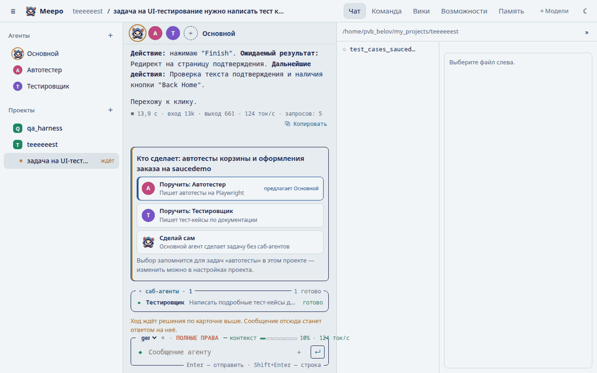
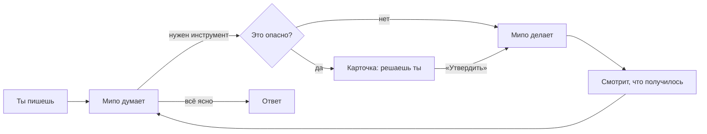

# Мипо — помощник, который сам учится новому


**Мипо** (Meepo) — помощник, который живёт прямо у тебя в компьютере. С ним можно поболтать, попросить что-нибудь найти, прочитать файлы, пройтись по сайту в браузере или записать заметку. А если Мипо чего-то не умеет, он не притворяется: говорит «я так не умею» и предлагает научиться. Учится — только когда ты скажешь «да».



*На гифке: Мипо спрашивает, кому поручить автотесты; поручение и отчёт Тестировщика в чате; ход работы с вызовами браузера; команда агентов; тест-кейсы в файлах проекта; подключение Ollama в окне «Модели».*

## Как устроен Мипо

### Голова

Внутри Мипо — **языковая модель**. Это программа, которая прочитала очень много текстов и научилась их продолжать: ты пишешь вопрос, а она дописывает ответ. Модель может работать на твоём компьютере (её запускают Ollama или LM Studio) — тогда разговоры никуда не улетают. А можно подключить и сервер на работе или в облаке: адрес и ключ вводятся в окне **«⚙ Модели»**.

Голова у Мипо небольшая: за раз в ней помещается немного текста — примерно как номер телефона, который ты держишь в голове, пока набираешь. Как Мипо с этим справляется, рассказано [ниже](#как-мипо-не-забывает-главное).

### Глаза — картинки

Мипо умеет смотреть на картинки. Вставь скриншот или фото прямо в поле ввода (**Ctrl+V**), перетащи файл или нажми **＋**. Можно спросить, что на картинке, попросить переписать таблицу со скриншота или сохранить картинку в заметку вики — она появится в заметке, а не потеряется вместе с разговором.

### Руки — инструменты

Говорить мало, хочется делать. Для этого у Мипо есть **инструменты**:

- прочитать или записать файл;
- поискать в интернете;
- открыть сайт в настоящем браузере и пощёлкать по нему. Красная точка в окне браузера показывает, куда Мипо навёл мышку;
- записать заметку в вики.

Всё, что может что-нибудь испортить (записать файл, нажать кнопку на сайте), Мипо сначала **спрашивает**. Прямо в чате появляется карточка, и ты нажимаешь «Утвердить» или «Отклонить». Можно и ответить словами: «сделай, но назови файл по-другому».

Пока Мипо работает, в чате не мелькает каждый шаг: все вызовы инструментов и промежуточные мысли свёрнуты в строку **«◇ ход работы · 12 шагов»** над ответом. Раскрой её — и увидишь всё по порядку.

### Как Мипо учится новому

Если подходящего инструмента нет, Мипо прямо говорит: «Я так не умею. Давай сделаю себе такой инструмент?» — и показывает карточку: что он хочет сделать, зачем и сам код. Ты читаешь и решаешь. Без твоего «да» ничего не появится.

Научиться Мипо может трём вещам:

| Что | На что похоже | Где лежит |
| --- | --- | --- |
| Инструмент | Новая «рука»: умеет одно конкретное дело | `data/tools/<id>/` |
| Скилл | Шпаргалка: как делать задачи одного типа | `data/skills/<id>.md` |
| Саб-агент | Помощник в команде со своей ролью | `data/agents/<id>.md` |

Всё это — обычные файлы: их можно поправить руками и нажать «Перечитать с диска» на вкладке «Возможности». Ненужное Мипо предлагает убрать в архив, оттуда его можно вернуть.

### Команда помощников

Мипо — капитан команды. Большую задачу он может поручить **помощнику** (саб-агенту): Тестировщик пишет тест-кейсы, Автотестер — автотесты, Исследователь ищет в интернете. Помощник работает в фоне, а Мипо тем временем продолжает разговаривать с тобой. Когда помощник закончит, его отчёт придёт в чат, и Мипо сразу решит, что делать дальше.

**Кто делает задачу — решаешь ты.** Если для задачи есть подходящий помощник, Мипо показывает карточку **«Кто сделает»**: поручить ему, другому помощнику или сделать самому. Твой выбор запоминается для такого типа задач в проекте («автотесты → Автотестер»), и в следующий раз Мипо поступит так же без вопроса. Запомненное видно и забывается в настройках проекта. Сказал прямо «сделай сам» или «поручи тестировщику» — карточки не будет.

Помощники тоже ведут себя честно:

- написал помощнику задачу не по его профилю — он не берётся за неё, а **передаёт Мипо**, и тот распределяет;
- не хватает данных или решения — помощник **спрашивает тебя** карточкой с полем ответа;
- не хватает инструмента, который в системе есть, — **просит подключить** его: утвердишь, и инструмент появится у помощника сразу;
- не получилось — так и пишет, ничего не выдумывая.

Помощники могут обращаться друг к другу: поручить часть задачи или спросить. Их переписка видна в чате тихими строками «◆ Тестировщик → Автотестер». На вкладке **«Команда»** — справочник: кто в команде и кто к кому может обращаться. Щелчок по карточке открывает настройки помощника: роль, инструменты и к кому он может обращаться.

Все агенты пишут **по-русски** — и ответы, и файлы, и отчёты, — пока ты сам не попросишь другой язык.

### Память — записная книжка о тебе

Расскажи, как тебя зовут и что ты любишь, — Мипо запишет. В следующий раз он не перечитывает всю книжку: заглядывает в короткую анкету и в пару записей, которые подходят к твоему вопросу. Всё записанное видно на вкладке **«Память»**.

### Вики — тетрадка с заметками

Пришли в «Чат вики» текст или ссылку и скажи «добавь заметку». Мипо поищет похожую заметку: найдёт — допишет её, не найдёт — заведёт новую.

Чтобы быстро найти заметку, нажми **Ctrl+K** и начни печатать: сначала покажутся заметки, у которых совпало название или тег, ниже — те, где слово есть в тексте. Стрелки и Enter открывают заметку. Теги над списком — как закладки в тетрадке: щёлкни `#тестирование`, и останутся только заметки про тестирование. Без поиска сверху лежат недавние заметки, а остальные разложены по темам.

Заметки связаны ссылками, как ниточками. На вкладке **«Вики» → «Граф»** видна вся паутинка: точка — заметка, линия — ссылка. Чем больше у заметки связей, тем крупнее точка, а цвет показывает, к какой «кучке» тем она относится. Щелчок по точке открывает заметку.

Старые версии заметок не пропадают. Кнопка **lint** (или команда `/lint`) просит Мипо найти в тетрадке противоречия и повторы: он предложит правки, а применятся только те, что ты отметишь.

### Файлы — папка проекта

Каждый разговор живёт в **проекте** — папке на компьютере, с которой работает Мипо. Справа от чата — её файлы: их можно посмотреть и поправить, а файл, который Мипо только что записал, открывается сам с подсвеченными изменениями. Если включить у проекта режим «только чтение», Мипо в папке ничего не поменяет.

### Как Мипо не забывает главное

Голова маленькая, поэтому Мипо хитрит:

- **Умения — одной строчкой.** Список всего, что Мипо умеет, короткий: имя и одна строчка описания. Подробную инструкцию к инструменту он достаёт, только когда собрался им пользоваться.
- **Длинный разговор — пересказом.** Начало разговора Мипо коротко пересказывает себе, а старые результаты инструментов обрезает.
- **В браузере — свежий взгляд.** После каждого шага Мипо снова смотрит на страницу, а старые «фотографии» страницы выбрасывает. При этом он помнит, что уже сделал и что нашёл.

### Один ход Мипо



Ход идёт на сервере, а не во вкладке браузера: если закрыть вкладку, Мипо доделает начатое. Остановить его можно кнопкой ■ или клавишей Esc.

## Для взрослых

### Запуск

Нужны Python 3.11+, [`uv`](https://docs.astral.sh/uv/) и сервер модели с OpenAI-совместимым API: Ollama, LM Studio, vLLM или облачный API с ключом. Для изоляции скриптов агента нужен `bwrap` (пакет `bubblewrap`), для браузера — Node.js.

```bash
cp .env.example .env        # проверьте LLM_BASE_URL и DEFAULT_MODEL
uv sync
uv run local-agent           # уровень логов задаёт LOG_LEVEL в .env
```

Откройте [127.0.0.1:8000](http://127.0.0.1:8000/). Аутентификации нет: запускайте только на `127.0.0.1`.

- **Модели** — кнопка **«⚙ Модели»** вверху справа (или ⚙ рядом с выбором модели над полем ввода). Добавьте провайдера: тип (Ollama, LM Studio, OpenAI-совместимый), адрес и ключ, если он нужен; «Проверить подключение» сразу покажет список моделей. Там же — модель по умолчанию для новых проектов. Модели всех доступных провайдеров собираются в один список над полем ввода, выключенный сервер просто не показывается: дома видна Ollama, на работе — рабочий API, ничего переключать не нужно.
- **Через .env** тоже можно: `LLM_BASE_URL` (например, `http://127.0.0.1:11434/v1` для Ollama), `DEFAULT_MODEL`, дополнительные серверы — `LLM_PROVIDERS` с `api_key`. Такие провайдеры в окне «Модели» только показываются. Проверка TLS-сертификатов включена по умолчанию; `LLM_VERIFY_SSL=false` отключает её для всех провайдеров. Это снижает безопасность соединения и может подвергнуть API-ключи перехвату.
- **Проекты** — в панели слева: «＋ проект» создаёт новый, ✎ у проекта или его имя в шапке открывают настройки. При первом открытии интерфейс предлагает выбрать папку проекта. Удаление проекта удаляет его сессии с историей, папка на диске остаётся.
- **Саб-агенты на отдельной модели:** задайте `SUBAGENT_PROVIDER` и `SUBAGENT_MODEL`, чтобы фоновые задачи не ждали основную модель.

Все настройки и пути — в [.env.example](.env.example).

### Как это устроено внутри

- **Ход агента** — граф LangGraph (`src/local_agent/graph/agent_graph.py`): `call_model → approve → run_tools → call_model …`. Все подтверждения проходят через `interrupt` в узле `approve`, в котором нет побочных эффектов. Ход, который ждёт решения, хранится в SQLite-чекпоинте и в сессии, поэтому переживает перезагрузку страницы и сервера. Сообщение, отправленное во время хода, встаёт в очередь.
- **Провайдеры** из окна «Модели» хранятся в `data/providers.json` (права только у владельца, ключ в интерфейс не отдаётся — только хвост), регистрируются на лету рядом с заданными в `.env`.
- **Модель** вызывается своим провайдером (`llm/openai_compatible.py`): он передаёт рассуждения в UI, собирает вызовы инструментов из стрима и узнаёт размер окна у сервера. Пустой или зациклившийся ответ повторяется, последний раз без инструментов.
- **Компактный реестр.** В системный промпт попадает одна строка на каждый инструмент, скилл и саб-агента. Схемы параметров подключаются через `activate`, одновременно не больше 5; основные инструменты браузера подключаются одним набором и слотов не занимают. Подключённое запоминается на проект.
- **Реестр инструментов** единый: встроенные, созданные агентом и MCP регистрируются одинаково (`tools/registry.py`, `capabilities/`). Новое агент предлагает через `propose`, убирает через `archive`; готовые дополнения (например, `generate_test_cases`) лежат в архиве.
- **Скрипты агента** выполняются в песочнице (`capabilities/sandbox.py`): bubblewrap (файловая система только для чтения, домашняя папка скрыта, сеть закрыта, если инструмент не заявил её), таймаут, лимиты памяти и вывода, чистое окружение.
- **Коннекторы** — инструменты-скрипты, которым нужны доступы к рабочим системам (адрес, логин, токен или пароль). Они собраны в группе «Коннекторы» на вкладке «Возможности → Инструменты»; кнопка «настроить» открывает форму с понятными полями и подсказками, где взять значение, и «Проверить подключение». Значения хранятся в `data/secrets.json` (права только у владельца): токены и пароли обратно не показываются, только «задан»; адрес и логин видны. Агент значений не видит — скрипт получает переменными окружения только доступы из строки `secrets:` своего `tool.md` (имя с `?` — необязательное поле); если значение попало в вывод, оно заменяется на `***`.
- **Jira (только чтение)** — коннектор `data/tools/jira` (стандартная библиотека Python): мои незакрытые задачи, поиск по JQL, задача с описанием, связями и комментариями. Он кладётся туда при первом запуске из `src/local_agent/extras/tools/jira` и дальше ваш: код открывается кнопкой «код» и правится в окне или через агента (`propose` с `name: jira`); убранный в архив или удалённый не возвращается. В форме «настроить»: адрес Jira, токен, почта (только для Jira Cloud) и галочка проверки сертификата.
- **Пакеты для скриптов агента** — общее окружение песочницы `data/sandbox-env` (отдельное от окружения приложения). Агент просит поставить пакет PyPI через `install_packages`, каждая установка — с подтверждением; принимаются только имена пакетов с версией, без ссылок, путей и флагов pip. Инструмент перечисляет нужные пакеты в `requires:` в `tool.md`; если пакета нет, вызов не выполняется, и агент просит установить. Список и удаление — вкладка «Пакеты» в возможностях.
- **MCP** — серверы из `data/mcp.json` (создаётся при первом запуске): веб-поиск DuckDuckGo (`uvx duckduckgo-mcp-server`) и браузер Playwright (`@playwright/mcp`, версия закреплена). Без подтверждения выполняются только инструменты из `auto_approve` или с пометкой «только чтение». Снимок страницы после действия приходит прямо в ответе, в контексте хода остаётся только последний. `browser_run_code_unsafe` модели не показывается.
- **Саб-агенты** получают задачу через `delegate` и работают в фоне, в своём разговоре внутри сессии; итог сразу запускает ход основного агента. Друг к другу они обращаются через `ask_agent` (строка `agents:` в файле агента сужает круг; цепочка — не длиннее трёх, циклы отбиваются). У саб-агента в проекте есть `ask_user` (вопрос пользователю карточкой), `request_tools` (подключить инструмент из реестра после утверждения) и `handoff` (передать основному задачу не по профилю).
- **Кто делает задачу** — `choose_route` основного агента: карточка с выбором исполнителя; выбор сохраняется в проекте (`routes`: тип задачи → id агента или `main`) и попадает в промпт основного агента как маршрут.
- **Страховки движка** для маленьких моделей: ответ-обещание без вызова инструмента («Перехожу в корзину.») возвращается модели с просьбой сделать шаг; ответ не на русском переписывается до того, как попадёт в чат (не больше трёх раз за ход). Файловые инструменты срезают с путей обёртку из Markdown (`` `test.md`) `` → `test.md`).
- **Память** — короткий профиль (`profile.md`) и записи, найденные полнотекстовым поиском по сообщению. Факты записываются сразу (`remember`) по patch-контракту из [docs/memory-contract.md](docs/memory-contract.md), а раз в несколько сообщений разговор разбирается целиком.
- **Вики** — паттерн LLM Wiki: ingest, index, lint. Заметка — Markdown с OKF-фронтматтером (`type`, `title`, `description`, `tags`); `index.md` — одна строка на заметку: путь — описание — ключевые слова. «Добавь заметку»: `wiki_match` сверяет ключевые слова с индексом, совпали два и больше — заметка дополняется, иначе создаётся новая (`wiki_save_note`). Теги: варианты одного слова сводятся к одному тегу, агент выбирает из уже существующих, а lint предлагает слить синонимы. Чат вики живёт вне проектов, видит только инструменты вики и чтение ссылок и помнит последние `WIKI_CONTEXT_MESSAGES` реплик.
- **Картинки** из чата лежат в `data/attachments`, в сообщении — только их имена. Модели они уходят частями `image_url` в формате OpenAI, и только из последних трёх реплик; у более старых остаются имена. Нужна модель с поддержкой картинок (vision), например `gemma4:12b`. В заметку вики агент вставляет картинку через `wiki_save_note` с `images` — копия ложится в `data/wiki/images`.
- **Схемы**: блок ` ```mermaid ` в ответе, заметке вики или Markdown-файле рисуется диаграммой. Библиотека mermaid лежит в `ui/vendor` (без CDN) и грузится при первой диаграмме. Скрипты агента пишутся только на стандартной библиотеке Python: схему они выводят текстом Mermaid.
- **Бэкенд** — FastAPI, **UI** — чистый JS без сборки; об изменениях интерфейс узнаёт из потока `/api/events`.

### Где что лежит

| Путь | Что хранит |
| --- | --- |
| `data/sessions`, `data/conversations` | Сессии (JSON) и история (JSONL); дочерние сессии саб-агентов скрыты из списка |
| `data/projects` | Проекты: рабочая папка, провайдер, модель и маршруты «тип задачи → исполнитель» |
| `data/providers.json` | Провайдеры моделей из окна «Модели» с ключами API и модель по умолчанию |
| `data/memory` | Долговременная память о вас (Markdown) |
| `data/attachments` | Картинки из чата; удаляются вместе с сессией |
| `data/wiki`, `data/wiki-history` | Заметки вики (картинки к ним — в `data/wiki/images`) и прежние версии перезаписанных и удалённых заметок |
| `data/tools`, `data/skills`, `data/agents` | Созданные возможности; архив — в `.deleted` |
| `data/index` | Полнотекстовые индексы памяти, вики и документации проектов |
| `data/checkpoints.sqlite` | Ходы, которые ждут решения |
| `data/mcp.json`, `data/logs` | MCP-серверы и их журналы |
