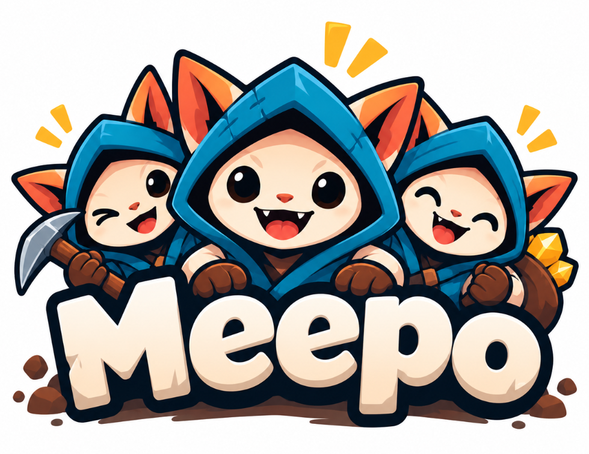
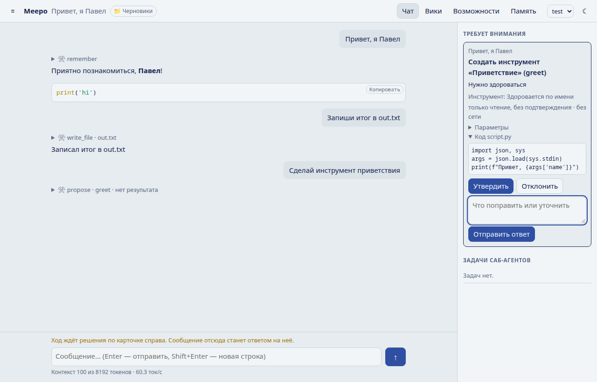
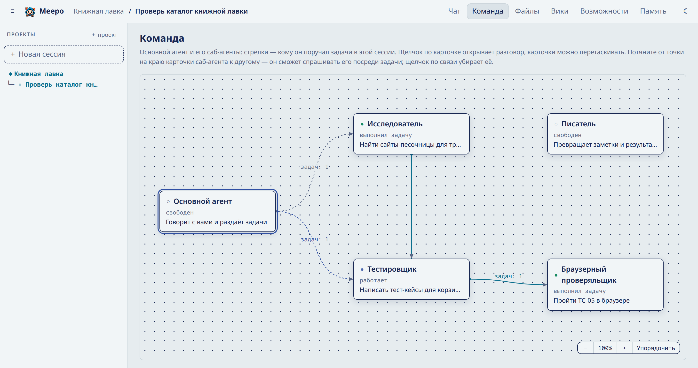
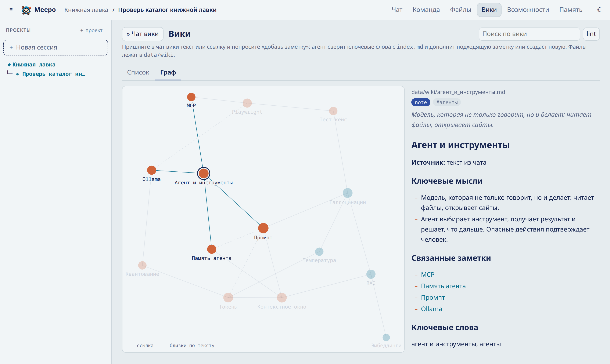
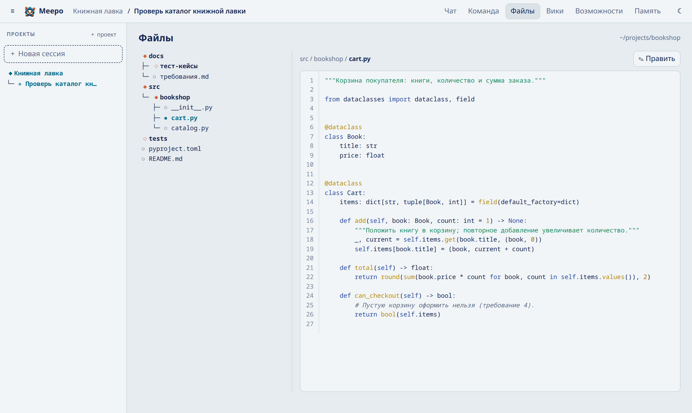
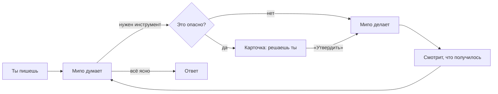

# Мипо — помощник, который сам учится новому



**Мипо** (Meepo) — помощник, который живёт прямо у тебя в компьютере. С ним можно поболтать, попросить что-нибудь найти, прочитать файлы, пройтись по сайту в браузере или записать заметку. А если Мипо чего-то не умеет, он не притворяется: говорит «я так не умею» и предлагает научиться. Учится — только когда ты скажешь «да».

## Как устроен Мипо

### Голова

Внутри Мипо — **языковая модель**. Это программа, которая прочитала очень много текстов и научилась их продолжать: ты пишешь вопрос, а она дописывает ответ. Модель работает на твоём компьютере (её запускают LM Studio или Ollama), поэтому разговоры никуда не улетают.

Голова у Мипо небольшая: за раз в ней помещается немного текста — примерно как номер телефона, который ты держишь в голове, пока набираешь. Как Мипо с этим справляется, рассказано [ниже](#как-мипо-не-забывает-главное).

### Глаза — картинки

Мипо умеет смотреть на картинки. Вставь скриншот или фото прямо в поле ввода (**Ctrl+V**), перетащи файл или нажми **＋**. Можно спросить, что на картинке, попросить переписать таблицу со скриншота или сохранить картинку в заметку вики — она появится в заметке, а не потеряется вместе с разговором.

### Руки — инструменты

Говорить мало, хочется делать. Для этого у Мипо есть **инструменты**:

- прочитать или записать файл;
- поискать в интернете;
- открыть сайт в настоящем браузере и пощёлкать по нему. Красная точка в окне браузера показывает, куда Мипо навёл мышку;
- записать заметку в вики.

Всё, что может что-нибудь испортить (записать файл, нажать кнопку на сайте), Мипо сначала **спрашивает**. Справа появляется карточка, и ты нажимаешь «Утвердить» или «Отклонить». Можно и ответить словами: «сделай, но назови файл по-другому».

### Как Мипо учится новому

Если подходящего инструмента нет, Мипо прямо говорит: «Я так не умею. Давай сделаю себе такой инструмент?» — и показывает карточку: что он хочет сделать, зачем и сам код. Ты читаешь и решаешь. Без твоего «да» ничего не появится.



Научиться Мипо может трём вещам:

| Что | На что похоже | Где лежит |
| --- | --- | --- |
| Инструмент | Новая «рука»: умеет одно конкретное дело | `data/tools/<id>/` |
| Скилл | Шпаргалка: как делать задачи одного типа | `data/skills/<id>.md` |
| Саб-агент | Помощник в команде со своей ролью | `data/agents/<id>.md` |

Всё это — обычные файлы: их можно поправить руками и нажать «Перечитать с диска» на вкладке «Возможности». Ненужное Мипо предлагает убрать в архив, оттуда его можно вернуть.

### Команда помощников

Мипо — капитан команды. Большую задачу он может поручить **помощнику** (саб-агенту): Исследователь ищет в интернете, Тестировщик пишет проверки, Браузерный проверяльщик ходит по сайтам. Помощник работает в фоне, а Мипо тем временем продолжает разговаривать с тобой. Когда помощник закончит, ответ придёт в чат.

На вкладке **«Команда»** видно всех сразу: кто свободен, кто работает, кто уже справился. Пунктирная стрелка — «кто кому давал задание». Сплошная линия — помощники, которые могут спрашивать друг друга посреди работы. Чтобы связать двоих, потяни от точки на краю одной карточки к другой. Щелчок по карточке открывает разговор с помощником.



### Память — записная книжка о тебе

Расскажи, как тебя зовут и что ты любишь, — Мипо запишет. В следующий раз он не перечитывает всю книжку: заглядывает в короткую анкету и в пару записей, которые подходят к твоему вопросу. Всё записанное видно на вкладке **«Память»**.

### Вики — тетрадка с заметками

Пришли в «Чат вики» текст или ссылку и скажи «добавь заметку». Мипо поищет похожую заметку: найдёт — допишет её, не найдёт — заведёт новую.

Чтобы быстро найти заметку, нажми **Ctrl+K** и начни печатать: сначала покажутся заметки, у которых совпало название или тег, ниже — те, где слово есть в тексте. Стрелки и Enter открывают заметку. Теги над списком — как закладки в тетрадке: щёлкни `#тестирование`, и останутся только заметки про тестирование. Без поиска сверху лежат недавние заметки, а остальные разложены по темам.

Заметки связаны ссылками, как ниточками. На вкладке **«Вики» → «Граф»** видна вся паутинка: точка — заметка, линия — ссылка. Чем больше у заметки связей, тем крупнее точка, а цвет показывает, к какой «кучке» тем она относится. Щелчок по точке открывает заметку.

Старые версии заметок не пропадают. Кнопка **lint** (или команда `/lint`) просит Мипо найти в тетрадке противоречия и повторы: он предложит правки, а применятся только те, что ты отметишь.



### Файлы — папка проекта

Каждый разговор живёт в **проекте** — папке на компьютере, с которой работает Мипо. На вкладке **«Файлы»** её можно посмотреть и поправить. Если включить у проекта режим «только чтение», Мипо в папке ничего не поменяет.



### Как Мипо не забывает главное

Голова маленькая, поэтому Мипо хитрит:

- **Умения — одной строчкой.** Список всего, что Мипо умеет, короткий: имя и одна строчка описания. Подробную инструкцию к инструменту он достаёт, только когда собрался им пользоваться.
- **Длинный разговор — пересказом.** Начало разговора Мипо коротко пересказывает себе, а старые результаты инструментов обрезает.
- **В браузере — свежий взгляд.** После каждого шага Мипо снова смотрит на страницу, а старые «фотографии» страницы выбрасывает. При этом он помнит, что уже сделал и что нашёл.

### Один ход Мипо



Ход идёт на сервере, а не во вкладке браузера: если закрыть вкладку, Мипо доделает начатое. Остановить его можно кнопкой ■ или клавишей Esc.

## Для взрослых

### Запуск

Нужны Python 3.11+, [`uv`](https://docs.astral.sh/uv/) и LM Studio (или Ollama) с загруженной моделью и включённым API-сервером. По умолчанию — `google/gemma-4-12b`. Для изоляции скриптов агента нужен `bwrap` (пакет `bubblewrap`), для браузера — Node.js.

```bash
cp .env.example .env        # проверьте LLM_BASE_URL и DEFAULT_MODEL
uv sync
uv run uvicorn local_agent.main:app --host 127.0.0.1
```

Откройте [127.0.0.1:8000](http://127.0.0.1:8000/). Аутентификации нет: запускайте только на `127.0.0.1`.

- **Ollama вместо LM Studio:** `LLM_BASE_URL=http://127.0.0.1:11434/v1`, `DEFAULT_MODEL=gemma4:12b`.
- **Проекты** — в панели слева: «＋ проект» создаёт новый, ✎ у проекта или его имя в шапке открывают настройки. При первом открытии интерфейс предлагает выбрать папку проекта. Удаление проекта удаляет его сессии с историей, папка на диске остаётся.
- **Саб-агенты на отдельной модели:** задайте `SUBAGENT_PROVIDER` и `SUBAGENT_MODEL`, чтобы фоновые задачи не ждали основную модель.

Все настройки и пути — в [.env.example](.env.example).

### Как это устроено внутри

- **Ход агента** — граф LangGraph (`src/local_agent/graph/agent_graph.py`): `call_model → approve → run_tools → call_model …`. Все подтверждения проходят через `interrupt` в узле `approve`, в котором нет побочных эффектов. Ход, который ждёт решения, хранится в SQLite-чекпоинте и в сессии, поэтому переживает перезагрузку страницы и сервера. Сообщение, отправленное во время хода, встаёт в очередь.
- **Модель** вызывается своим провайдером (`llm/openai_compatible.py`): он передаёт рассуждения в UI, собирает вызовы инструментов из стрима и узнаёт размер окна у сервера. Пустой или зациклившийся ответ повторяется, последний раз без инструментов.
- **Компактный реестр.** В системный промпт попадает одна строка на каждый инструмент, скилл и саб-агента. Схемы параметров подключаются через `activate`, одновременно не больше 5; основные инструменты браузера подключаются одним набором и слотов не занимают. Подключённое запоминается на проект.
- **Реестр инструментов** единый: встроенные, созданные агентом и MCP регистрируются одинаково (`tools/registry.py`, `capabilities/`). Новое агент предлагает через `propose`, убирает через `archive`; готовые дополнения (например, `generate_test_cases`) лежат в архиве.
- **Скрипты агента** выполняются в песочнице (`capabilities/sandbox.py`): bubblewrap (файловая система только для чтения, домашняя папка скрыта, сеть закрыта, если инструмент не заявил её), таймаут, лимиты памяти и вывода, чистое окружение.
- **MCP** — серверы из `data/mcp.json` (создаётся при первом запуске): веб-поиск DuckDuckGo (`uvx duckduckgo-mcp-server`) и браузер Playwright (`@playwright/mcp`, версия закреплена). Без подтверждения выполняются только инструменты из `auto_approve` или с пометкой «только чтение». Снимок страницы после действия приходит прямо в ответе, в контексте хода остаётся только последний. `browser_run_code_unsafe` модели не показывается.
- **Саб-агенты** получают задачу через `delegate` и работают в фоне, в дочерней сессии; друг друга спрашивают через `ask_agent`, если связаны на холсте (строка `agents:` в файле агента).
- **Память** — короткий профиль (`profile.md`) и записи, найденные полнотекстовым поиском по сообщению. Факты записываются сразу (`remember`) по patch-контракту из [docs/memory-contract.md](docs/memory-contract.md), а раз в несколько сообщений разговор разбирается целиком.
- **Вики** — паттерн LLM Wiki: ingest, index, lint. Заметка — Markdown с OKF-фронтматтером (`type`, `title`, `description`, `tags`); `index.md` — одна строка на заметку: путь — описание — ключевые слова. «Добавь заметку»: `wiki_match` сверяет ключевые слова с индексом, совпали два и больше — заметка дополняется, иначе создаётся новая (`wiki_save_note`). Теги: варианты одного слова сводятся к одному тегу, агент выбирает из уже существующих, а lint предлагает слить синонимы. Чат вики живёт вне проектов, видит только инструменты вики и чтение ссылок и помнит последние `WIKI_CONTEXT_MESSAGES` реплик.
- **Картинки** из чата лежат в `data/attachments`, в сообщении — только их имена. Модели они уходят частями `image_url` в формате OpenAI, и только из последних трёх реплик; у более старых остаются имена. Нужна модель с поддержкой картинок (vision), например `gemma4:12b`. В заметку вики агент вставляет картинку через `wiki_save_note` с `images` — копия ложится в `data/wiki/images`.
- **Бэкенд** — FastAPI, **UI** — чистый JS без сборки; об изменениях интерфейс узнаёт из потока `/api/events`.

### Где что лежит

| Путь | Что хранит |
| --- | --- |
| `data/sessions`, `data/conversations` | Сессии (JSON) и история (JSONL); дочерние сессии саб-агентов скрыты из списка |
| `data/projects` | Проекты: рабочая папка, провайдер и модель |
| `data/memory` | Долговременная память о вас (Markdown) |
| `data/attachments` | Картинки из чата; удаляются вместе с сессией |
| `data/wiki`, `data/wiki-history` | Заметки вики (картинки к ним — в `data/wiki/images`) и прежние версии перезаписанных и удалённых заметок |
| `data/tools`, `data/skills`, `data/agents` | Созданные возможности; архив — в `.deleted` |
| `data/index` | Полнотекстовые индексы памяти, вики и документации проектов |
| `data/checkpoints.sqlite` | Ходы, которые ждут решения |
| `data/mcp.json`, `data/logs` | MCP-серверы и их журналы |

### Проверка

```bash
uv sync --all-extras
uv run ruff check src tests
uv run pytest
# на живой модели (LM Studio или Ollama):
LM_STUDIO_TEST_MODEL=gemma4:12b LLM_BASE_URL=http://127.0.0.1:11434/v1 uv run pytest tests/test_live_lm_studio.py
# spike: tool calling, structured output, interrupt/resume на модели
uv run --extra spike python spikes/gemma_langgraph.py --ollama
```

### Генерация тест-кейсов из командной строки

Конвейер из `extras/testgen` можно запустить и без агента:

```bash
uv run python -m local_agent.extras.testgen "docs/раздел" --workspace ~/project --limit 10
```
